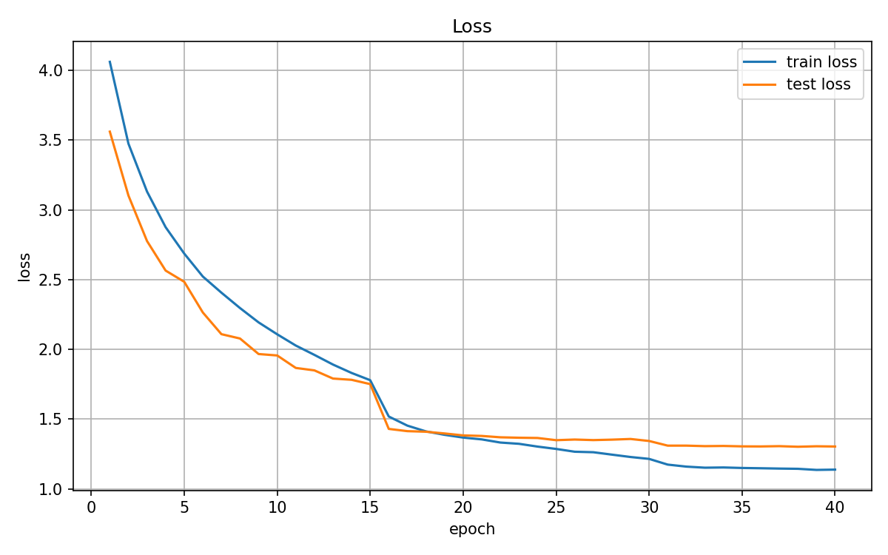
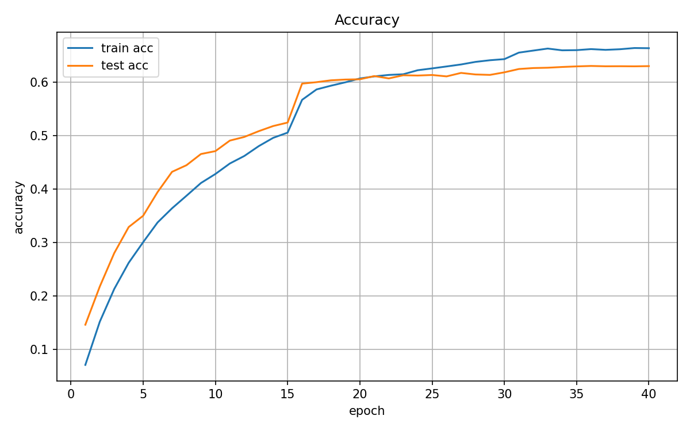
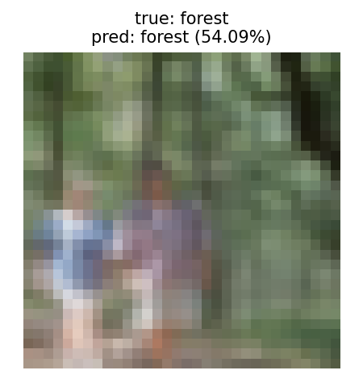
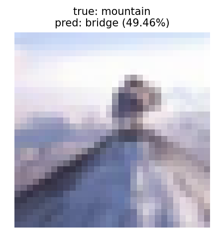
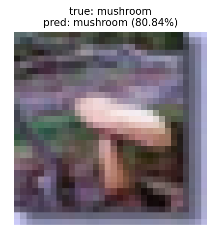

# AlexNet on CIFAR-100

[](https://github.com/Wait4theWind/alexnet-cifar100/actions/workflows/python-app.yml)

从零手写的 AlexNet，适配 CIFAR-100 的 32x32 输入，包含 BatchNorm、Dropout 和训练/推理脚本。

## 项目概览

- 模型：5 层卷积 + 3 层全连接，参数量约 7.03 M
- 数据集：CIFAR-100（50,000 张训练图 / 10,000 张测试图，100 类）
- 输入：3 x 32 x 32，使用 CIFAR-100 均值与标准差归一化
- 数据增强：`RandomCrop(32, padding=4)` + `RandomHorizontalFlip()`
- 训练：SGD + StepLR，自动保存最佳权重
- 在线演示：Hugging Face Space

最终测试集准确率：**63.01%**（第 36 个 epoch）

## 模型结构

| 阶段 | 配置 | 输出尺寸 |
| --- | --- | --- |
| Conv1 + BN + ReLU | 3→64, k=3, s=1, p=1 | 64 x 32 x 32 |
| MaxPool | k=2, s=2 | 64 x 16 x 16 |
| Conv2 + BN + ReLU | 64→192, k=3, s=1, p=1 | 192 x 16 x 16 |
| MaxPool | k=2, s=2 | 192 x 8 x 8 |
| Conv3 + BN + ReLU | 192→384, k=3, s=1, p=1 | 384 x 8 x 8 |
| Conv4 + BN + ReLU | 384→256, k=3, s=1, p=1 | 256 x 8 x 8 |
| Conv5 + BN + ReLU | 256→256, k=3, s=1, p=1 | 256 x 8 x 8 |
| MaxPool | k=2, s=2 | 256 x 4 x 4 |
| Flatten | 256 x 4 x 4 | 4096 |
| FC1 + ReLU + Dropout | 4096→1024 | 1024 |
| FC2 + ReLU + Dropout | 1024→512 | 512 |
| FC3 | 512→100 | 100 |

三次池化把特征图从 32x32 缩小到 4x4，因此展平维度为 `256 * 4 * 4 = 4096`。

## 目录结构

```
alexnet-cifar100/
├─ src/
│  ├─ model.py          # 模型定义与形状/参数量自测
│  ├─ train.py          # 训练、评估、调度器、metrics.json
│  └─ predict.py        # 加载权重，打印预测并保存正确/错误样例图
├─ assets/              # 曲线图与预测样例图
├─ checkpoints/metrics.json
├─ .github/workflows/python-app.yml
├─ requirements.txt
└─ README.md
```

## 环境依赖

- Python 3.10+
- PyTorch / torchvision（GPU 训练，CPU 也可运行）
- matplotlib、Pillow

```bash
pip install -r requirements.txt
```

## 复现

```bash
pip install -r requirements.txt
python src/model.py
python src/train.py --epochs 40
python src/predict.py --weights checkpoints/best_model.pth
```

CIFAR-100 会自动下载到 `./data`，权重和 `metrics.json` 默认保存到 `./checkpoints`。

## 训练曲线





## 预测样例

| 预测正确 | 预测错误 |
| --- | --- |
|  |  |
|  | |

## 在线演示

- Model：https://huggingface.co/bbbegemot/alexnet-cifar100
- Space：https://huggingface.co/spaces/bbbegemot/alexnet-cifar100-demo

## 已知局限

- 输入固定为 32x32，真实照片缩小后细节损失明显
- CIFAR-100 类别间差异细微，模型容量与训练轮次有限
- 预期准确率明显低于 ResNet / ViT 等现代架构
- 仅用于学习与演示，不适用于安全关键场景

## 参考

- [Dive into Deep Learning - 卷积神经网络](https://zh.d2l.ai/chapter_convolutional-neural-networks/index.html)
- [Dive into Deep Learning - AlexNet](https://zh.d2l.ai/chapter_convolutional-modern/alexnet.html)
- [AlexNet 论文](https://papers.nips.cc/paper/2012/hash/c399862d3b9d6b76c8436e924a68c45b-Abstract.html)
